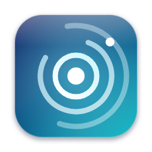

# Sonary

Eine native, quelloffene Mac-Menüleisten-App (Swift 6, SwiftUI, Liquid Glass auf macOS 26, nur Apple Silicon).
Modular aufgebaut: jede Funktion ist ein einzeln aktivierbares Modul.

Status: im Aufbau. Spec: `docs/superpowers/specs/`, Plan: `docs/superpowers/plans/`.

Lizenz: GPL-3.0-or-later, siehe `LICENSE` und `NOTICE`.

## Installation und Updates
Lade die aktuelle `Sonary-<Version>.dmg` von den Releases, ziehe Sonary in den Programme-Ordner und öffne es mit Rechtsklick, Öffnen (die App ist noch nicht notarisiert). Danach erkennt Sonary neue Versionen selbst und aktualisiert sich per Klick. Details: `docs/RELEASING.md`.
