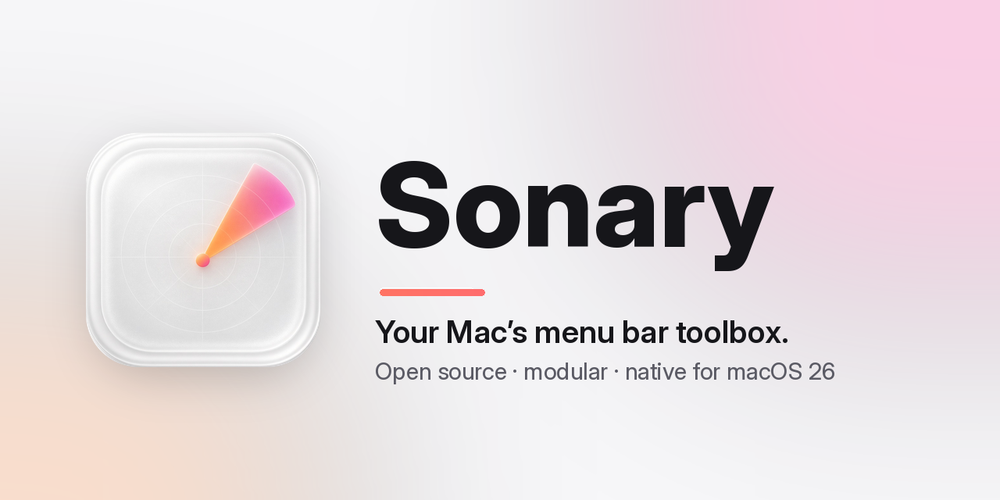
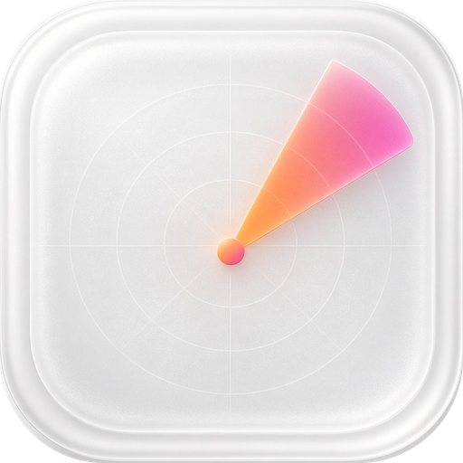

<p align="center">
  <picture>
    <source media="(prefers-color-scheme: dark)" srcset="assets/banner-dark.png">
    
  </picture>
</p>

<p align="center">
  <b>A whole drawer of Mac utilities behind one menu bar icon.</b><br>
  Free, open source, modular. Turn on only what you need.
</p>

<p align="center">
  <a href="#install">Install</a> ·
  <a href="#modules">Modules</a> ·
  <a href="#roadmap">Roadmap</a> ·
  <a href="#build-from-source">Build</a> ·
  <a href="CONTRIBUTING.md">Contributing</a>
</p>

<p align="center">
  <a href="https://github.com/nisayera/sonary/releases"></a>
  
  
  
  <a href="LICENSE"></a>
  
</p>

> [!NOTE]
> **Sonary is in early development.** The app shell, module system, the System Monitor, Mouse, Notch, Clipboard, App Management, Windows, Sound, Tools, Keyboard and Display modules are released (v0.12). The other modules below are the plan, not finished features. Star or watch the repo to follow along.

---

Sonary is a native menu bar app for macOS 26. Every feature is a **module** you can switch on or off: a disabled module doesn't load, doesn't run in the background and doesn't ask for permissions. No account, no telemetry, no paywall.

## Why Sonary

- **Modular.** One app, many tools. Enable just the ones you use.
- **Native.** Swift 6 and SwiftUI, designed for Liquid Glass on macOS 26.
- **Private.** Everything runs locally. Sonary only reaches the network for the update check, the app update checker and the speed test — the last two only when you ask.
- **Free.** GPL-3.0-or-later. No subscription, no "Pro" tier.
- **Bilingual.** English and German interface.

## Modules

| Module | What it will do | Status |
| --- | --- | --- |
| 📊 **System Monitor** | CPU, GPU, RAM, network, disk, battery and temperatures in the menu bar, with history and alerts | ✅ Available |
| 🖱 **Mouse** | Linear or smooth scrolling, acceleration off, button mapping, click filter, per-app exceptions | ✅ Available |
| 🏝 **Notch / Dynamic Island** | Music, calendar, timers, downloads and accessory batteries around the notch (simulated on displays without one) | ✅ Available |
| 📋 **Clipboard & Files** | Clipboard history, file shelf, clean tracking parameters from links, plain-text paste, Finder helpers | ✅ Available |
| 🧹 **App Management** | Cleaner, uninstaller with leftovers, quit and force quit, port manager, Homebrew updates | ✅ Available |
| 🪟 **Windows** | Window layouts (halves, quarters, thirds, maximize, center) on shortcuts, ⌘Q quit protection | ✅ Available |
| 🔊 **Sound** | Output and input switcher, volume, microphone mute shortcut, keep awake | ✅ Available |
| ⌨️ **Keyboard** | Super Key: hold one key for ⌃⌥⇧⌘, tap it for an action, with per-app exceptions | ✅ Available |
| ☀️ **Display** | Per-display brightness with shortcuts, software dimming where macOS offers no control | ✅ Available |
| 🧰 **Tools** | Command bar, text from screen (OCR), color picker, screenshots, scratchpad, snippets | ✅ Available |

## Install

Download the latest `Sonary-<version>.dmg` from [Releases](https://github.com/nisayera/sonary/releases) and drag Sonary into Applications.

Sonary is **not notarized yet**, so macOS blocks the first launch: right-click Sonary, choose **Open**, then **Open** again (or run `xattr -dr com.apple.quarantine /Applications/Sonary.app`). After that, Sonary checks for new versions by itself and updates in one click via [Sparkle](https://sparkle-project.org).

A Homebrew cask is planned.

### Requirements

- Mac with Apple Silicon
- macOS 26 Tahoe or newer

## Build from source

```sh
git clone https://github.com/nisayera/sonary.git
cd sonary
brew install xcodegen
xcodegen generate
open Sonary.xcodeproj
```

Requires Xcode 26. The Xcode project is generated from `project.yml`. See [CONTRIBUTING.md](CONTRIBUTING.md) for project layout and conventions.

## Roadmap

- [x] **M0 — Foundation:** app shell, menu bar extra, module system, settings, onboarding, launch at login, localization, in-app updates
- [x] **M1 — System Monitor**
- [x] **M2 — Mouse**
- [x] **M3 — Notch / Dynamic Island**
- [x] **M4 — Clipboard & Files**
- [x] **M5 — App Management**
- [x] **M6 — Windows** (Dock clicks and app switcher later)
- [x] **M7 — Sound** (per-app mixer and display brightness later)
- [x] **M8 — Tools**
- [x] **0.10 — Super Key, notch gestures, window switcher, brightness, quick toggles, radial menu**
- [x] **0.12 — clipboard images and auto-clear, busiest apps and fans, horizontal scroll, key debounce, scheduled cleaning, scratchpad tabs, cleaning mode**
- [x] **0.21 — scrolling screenshots, stitched automatically**
- [x] **0.20 — screenshot editor: arrows, boxes, highlights, text, redaction and backgrounds**
- [x] **0.19 — Dock actions and previews, switcher filters, hold to quit, typed snippets, Finder cut and rename, microphone meter, notch camera, extra radial rings, modifier-drag, files and scripts in the command bar**
- [x] **0.17 — fixed Space order, three-finger middle click, extra brightness on XDR panels**
- [x] **0.16 — fill the screen without a new Space, GIFs from videos, a file shelf in the notch, Sonary's own capture selector**
- [x] **0.15 — central shortcut manager: every shortcut on one page, recordable and resettable**
- [x] **0.14 — screen recording, image conversion and video shrinking, speed test, Bluetooth off during sleep, disk image installer**
- [x] **0.13 — adjustable transparency, edge snapping, focus follows mouse, switcher previews, menu commands and clipboard history in the command bar, pinned screenshots, camera preview, Markdown preview, media-key guard, keep-awake conditions, app update checker, clipboard image to Finder**

Every milestone ships as its own release: M2 is 0.3.0, M8 is 0.9.0, and 1.0 arrives when the plan is done.

## Feature checklist

What is done, partly done and still open: [docs/FEATURES.md](docs/FEATURES.md).

## Privacy

Sonary works offline. It collects no analytics and has no account. Permissions such as Accessibility or Screen Recording are requested only when you enable a module that needs them.

## License

Sonary is licensed under the [GNU GPL v3.0 or later](LICENSE). Code adapted from other open-source projects is credited in [NOTICE](NOTICE).

<p align="center"><br><sub>Made with ♥ for the Mac.</sub></p>
